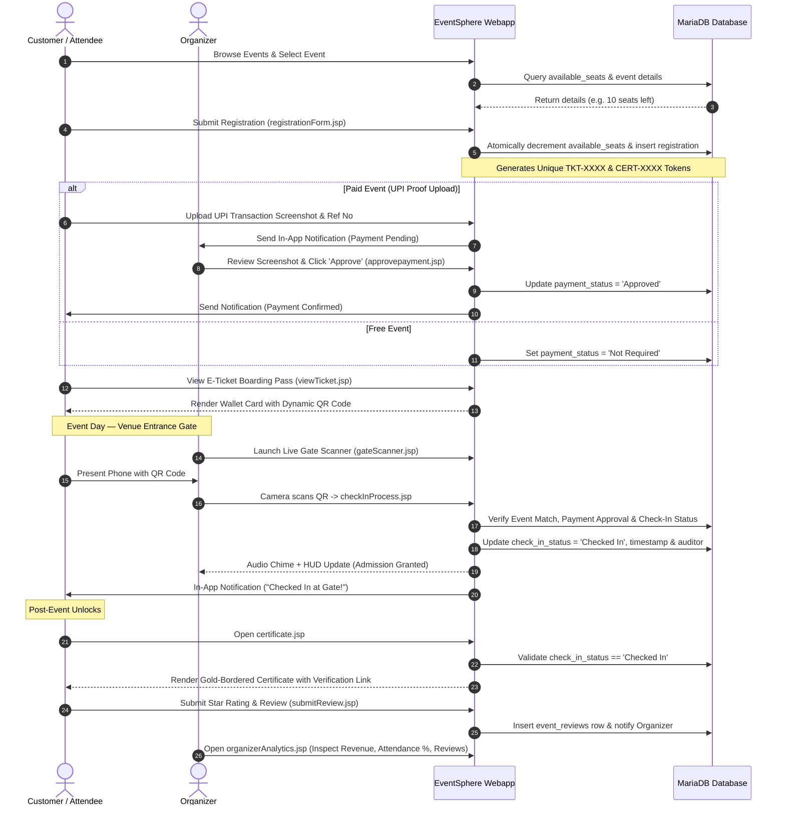
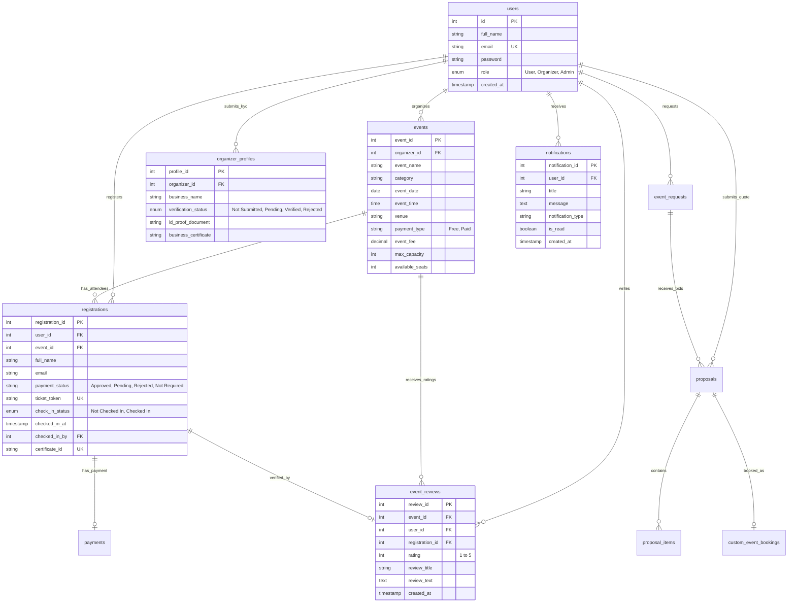

# EventSphere — Comprehensive Technical Project Report & Presentation Review Guide

---

## 1. Executive Summary & Abstract

**EventSphere** is an enterprise-grade, full-stack Java web platform engineered to solve the operational challenges of modern campus, corporate, and public event management. Built atop the **Jakarta EE 10 / Servlet 6.0** specification, **Apache Tomcat 10**, and **MySQL/MariaDB**, EventSphere bridges the communication and transaction gap between three core stakeholder personas: **Customers (Attendees)**, **Event Organizers**, and **Platform Administrators**.

The platform provides a complete end-to-end digital lifecycle: from dynamic event discovery, atomic seat-guarded registration, and dual-mode payment checkout (Sandbox Instant vs. Manual UPI QR screenshot verification), to a custom quotation and proposal negotiation marketplace. Crucially, EventSphere incorporates advanced differentiators: **Digital E-Ticket "Boarding Passes"** with dynamic scannable QR codes, a **Live WebRTC Camera QR Gate Scanner** for entrance check-ins, **Gate-Locked Verified Certificates of Participation** with public cryptographic lookup, an **Attendee Star Ratings & Social Proof Engine**, and an **Organizer Performance & Revenue Analytics Dashboard**.

---

## 2. Problem Statement & Motivation

Traditional event management systems (especially across academic institutions, colleges, and regional venues) suffer from critical fragmentation:
1. **Manual Gate Check-Ins & Fraud**: Reliance on paper rosters or unverified entry leads to ticket duplication, gate congestion, and unauthorized attendance.
2. **Disconnected Payment Verification**: Organizers have no standardized method to verify student UPI transfers, leading to manual spreadsheet reconciliations and seat allocation errors.
3. **Fake Certificates & Credential Inflation**: Participation certificates are easily forged using image editors because they lack cryptographic linkage to gate attendance.
4. **Lack of Negotiation for Custom Events**: Users seeking custom private venues (hackathons, cultural fests, conferences) have to communicate via unorganized phone calls rather than structured, itemized bidding.
5. **No Social Proof or Feedback Loop**: Attendees cannot review events, preventing high-quality organizers from building credible campus reputations.

**EventSphere** solves every single one of these problems through a unified, role-based architecture.

---

## 3. Technology Stack & Architectural Matrix

EventSphere adopts a modular **Model-View-Controller (MVC) Tiered Architecture**:

| Architectural Tier | Technologies Used | Key Libraries & Specifications |
| :--- | :--- | :--- |
| **Presentation Tier (Frontend)** | JSP, HTML5, Modern CSS3 (Glassmorphism & Dark Theme), Vanilla JavaScript (ES6+) | `qrcode.min.js`, `jsQR.js` (Computer Vision QR Decoder), HTML5 Web Audio API, WebRTC MediaStream API |
| **Controller & Business Logic** | Java Servlets, Standard Actions, Scriptlets, Custom DAO Layers | **Jakarta Servlet 6.0**, JDK 21/26, Apache Tomcat 10.1.57, `DBConnection.java`, `SecurityUtil.java`, `NotificationDAO.java` |
| **Persistence Tier (Database)** | Relational RDBMS, Relational Integrity, Foreign Keys, Triggers, Atomic Transactions | **MariaDB 10.4 / MySQL 8.0**, InnoDB Engine, UTF-8mb4 Unicode |
| **Security & Quality Assurance** | SHA-256 Cryptographic Hashing, Parameterized Statements, Sanitization, Automated Testing | Role-Based Access Control (RBAC), Automated PowerShell Test Suite (37/37 passing) |

---

## 4. System Architecture & Workflow Diagrams

### 4.1 Role Hierarchy & Interaction Matrix

```mermaid
flowchart TD
    subgraph Users["Stakeholder Personas"]
        Customer["👤 Customer / Attendee"]
        Organizer["🎪 Event Organizer"]
        Admin["🛡️ System Administrator"]
    end

    subgraph CoreEngine["EventSphere Core Engine"]
        Discovery["Dynamic Discovery & Catalog"]
        BookingEngine["Atomic Registration & Seat Allocator"]
        B2BMarketplace["Custom Requests & Quotation Marketplace"]
        GateSecurity["Live QR Gate Scanner & Admissions"]
        TrustEngine["Organizer KYC & Trust Verification"]
        FeedbackAnalytics["Reviews & Revenue Analytics"]
    end

    Customer -->|Browses & Filters| Discovery
    Customer -->|Books Free or Paid| BookingEngine
    Customer -->|Submits Private Specs| B2BMarketplace
    Customer -->|Passes QR Ticket| GateSecurity
    Customer -->|Submits Review & Rating| FeedbackAnalytics

    Organizer -->|Creates & Publishes Events| Discovery
    Organizer -->|Verifies UPI Payments| BookingEngine
    Organizer -->|Submits Itemized Proposals| B2BMarketplace
    Organizer -->|Operates Camera Scanner| GateSecurity
    Organizer -->|Submits KYC Credentials| TrustEngine
    Organizer -->|Monitors Revenue & Feedback| FeedbackAnalytics

    Admin -->|Audits & Verifies Organizers| TrustEngine
    Admin -->|Platform Oversight & User Management| CoreEngine
```



---

### 4.2 End-to-End Event Lifecycle Sequence Diagram



---

## 5. Comprehensive Module Breakdown (Frontend & Backend)

### Module 1: Authentication, Role-Based Access Control (RBAC) & Session Security
- **Frontend ([login.jsp](file:///c:/apache-tomcat-10.1.57/webapps/Eventsphere/login.jsp), [register.jsp](file:///c:/apache-tomcat-10.1.57/webapps/Eventsphere/register.jsp)):**
  - Cosmic gradient UI with client-side form validation.
  - Role selection: User / Customer vs. Event Organizer.
- **Backend ([loginProcess.jsp](file:///c:/apache-tomcat-10.1.57/webapps/Eventsphere/loginProcess.jsp), [SecurityUtil.java](file:///c:/apache-tomcat-10.1.57/webapps/Eventsphere/src/database/SecurityUtil.java)):**
  - SHA-256 cryptographic password hashing with hex conversion.
  - Session state provisioning: stores `userId`, `userName`, `email`, and `role`.
  - Guard clauses across all organizer and admin dashboards redirecting unauthorized users (`HTTP 302`).

---

### Module 2: Dynamic Event Discovery, Categorization & Capacity Management
- **Frontend ([index.jsp](file:///c:/apache-tomcat-10.1.57/webapps/Eventsphere/index.jsp), [eventDetails.jsp](file:///c:/apache-tomcat-10.1.57/webapps/Eventsphere/eventDetails.jsp)):**
  - Dynamic discovery feed with category quick-filter pills (Technical, Gaming, Cultural, Sports, Workshops).
  - Real-time search by keywords (name, venue, description).
  - Visual badges: Capacity counters (`seats left`), fee badge, deadline countdown, and star rating indicator (`★ 5.0 (12)`).
- **Backend ([saveEvent.jsp](file:///c:/apache-tomcat-10.1.57/webapps/Eventsphere/saveEvent.jsp), [updateEvent.jsp](file:///c:/apache-tomcat-10.1.57/webapps/Eventsphere/updateEvent.jsp), [deleteEvent.jsp](file:///c:/apache-tomcat-10.1.57/webapps/Eventsphere/deleteEvent.jsp)):**
  - Full CRUD operations with multi-tenant organizer isolation (`WHERE organizer_id = ?`).
  - Automated file upload handlers for event banners.
  - Initializer sets `available_seats = max_capacity`.

---

### Module 3: Atomic Booking Engine & Dual-Mode Payment Checkout
- **Frontend ([registrationForm.jsp](file:///c:/apache-tomcat-10.1.57/webapps/Eventsphere/registrationForm.jsp), [registrationSuccess.jsp](file:///c:/apache-tomcat-10.1.57/webapps/Eventsphere/registrationSuccess.jsp)):**
  - Dynamic fee display: If event is **Free**, displays instant registration; if **Paid**, displays organizer's UPI ID, dynamically generated UPI QR code, and payment proof upload input.
  - Team or individual registration fields.
- **Backend ([registerEvent.jsp](file:///c:/apache-tomcat-10.1.57/webapps/Eventsphere/registerEvent.jsp)):**
  - **Atomicity Guard**: Executes `UPDATE events SET available_seats = available_seats - 1 WHERE event_id = ? AND available_seats > 0` before inserting registration.
  - **Token Generation**: Generates cryptographically unique `ticket_token` (`TKT-XXXX-XXXXXX`) and `certificate_id` (`CERT-XXXX-XXXXXX`).
  - Dispatches notifications to both attendee and organizer.

---

### Module 4: Payment Verification & Dynamic Seat Restoration
- **Frontend ([viewParticipants.jsp](file:///c:/apache-tomcat-10.1.57/webapps/Eventsphere/viewParticipants.jsp)):**
  - Table of registered attendees with payment screenshot proof modal link, transaction reference codes, and status tags (`🟡 Pending`, `✅ Approved`, `❌ Rejected`, `🎉 Free`).
- **Backend ([approvepayment.jsp](file:///c:/apache-tomcat-10.1.57/webapps/Eventsphere/approvepayment.jsp), [rejectPayment.jsp](file:///c:/apache-tomcat-10.1.57/webapps/Eventsphere/rejectPayment.jsp)):**
  - **Approval**: Sets `payment_status = 'Approved'`, unlocks the attendee's E-Ticket, and sends confirmation notification.
  - **Rejection**: Sets `payment_status = 'Rejected'` and **automatically restores 1 seat** to the event's `available_seats` count.

---

### Module 5: Custom Event Quotation & Negotiation Marketplace
- **Frontend ([requestEvent.jsp](file:///c:/apache-tomcat-10.1.57/webapps/Eventsphere/requestEvent.jsp), [incomingRequests.jsp](file:///c:/apache-tomcat-10.1.57/webapps/Eventsphere/incomingRequests.jsp), [createProposal.jsp](file:///c:/apache-tomcat-10.1.57/webapps/Eventsphere/createProposal.jsp), [viewProposals.jsp](file:///c:/apache-tomcat-10.1.57/webapps/Eventsphere/viewProposals.jsp)):**
  - Attendees publish custom requirements (e.g., Annual Tech Symposium, 500 guests, budget ₹1,50,000, catering, stage, sound).
  - Verified organizers submit detailed itemized proposals (Item name, description, unit price, quantity, advance payment requested).
  - Attendees compare competing bids side-by-side.
- **Backend ([submitEventRequest.jsp](file:///c:/apache-tomcat-10.1.57/webapps/Eventsphere/submitEventRequest.jsp), [submitProposal.jsp](file:///c:/apache-tomcat-10.1.57/webapps/Eventsphere/submitProposal.jsp), [respondProposal.jsp](file:///c:/apache-tomcat-10.1.57/webapps/Eventsphere/respondProposal.jsp)):**
  - State machine transitions (`Submitted` $\rightarrow$ `Under Review` $\rightarrow$ `Quoted` $\rightarrow$ `Booked` / `Declined`).
  - Upon acceptance, atomically creates a booking in `custom_event_bookings` and marks competing proposals as rejected.

---

### Module 6: Organizer Trust, KYC & Administrator Verification Engine
- **Frontend ([organizerProfile.jsp](file:///c:/apache-tomcat-10.1.57/webapps/Eventsphere/organizerProfile.jsp), [adminVerifications.jsp](file:///c:/apache-tomcat-10.1.57/webapps/Eventsphere/adminVerifications.jsp), [adminDashboard.jsp](file:///c:/apache-tomcat-10.1.57/webapps/Eventsphere/adminDashboard.jsp)):**
  - Organizers submit business name, contact information, identity credentials, and upload Government/College ID and Registration Certificates.
  - Admin audit portal displays pending applications with document inspection links, one-click Approve / Reject buttons, and admin audit notes.
- **Backend ([updateOrganizerProfile.jsp](file:///c:/apache-tomcat-10.1.57/webapps/Eventsphere/updateOrganizerProfile.jsp), [adminProcessVerification.jsp](file:///c:/apache-tomcat-10.1.57/webapps/Eventsphere/adminProcessVerification.jsp)):**
  - Stores KYC metadata in `organizer_profiles`.
  - Sets `verification_status` to `'Verified'`. Once approved, the platform awards a permanent **`✔ Verified Host`** badge across all event cards, details pages, and public certificates.

---

### Module 7: Real-Time In-App Notification Center & Toast Feedback
- **Frontend ([navbarNotification.jsp](file:///c:/apache-tomcat-10.1.57/webapps/Eventsphere/navbarNotification.jsp), [notifications.jsp](file:///c:/apache-tomcat-10.1.57/webapps/Eventsphere/notifications.jsp), [notifications.js](file:///c:/apache-tomcat-10.1.57/webapps/Eventsphere/js/notifications.js), [toast.js](file:///c:/apache-tomcat-10.1.57/webapps/Eventsphere/js/toast.js)):**
  - Vector SVG bell icon with dynamic glowing unread badge counter.
  - Dropdown popup menu with live notification stream.
  - Animated non-blocking toast alerts for real-time events.
- **Backend ([getNotifications.jsp](file:///c:/apache-tomcat-10.1.57/webapps/Eventsphere/getNotifications.jsp), [markNotificationRead.jsp](file:///c:/apache-tomcat-10.1.57/webapps/Eventsphere/markNotificationRead.jsp), [NotificationDAO.java](file:///c:/apache-tomcat-10.1.57/webapps/Eventsphere/src/database/NotificationDAO.java)):**
  - RESTful JSON endpoints polled via asynchronous `fetch()`.
  - Supports marking individual or all notifications as read.

---

### Module 8: Digital E-Ticket Pass, Live QR Gate Scanner & Verified Certificates (Unique Differentiator)
- **Frontend ([viewTicket.jsp](file:///c:/apache-tomcat-10.1.57/webapps/Eventsphere/viewTicket.jsp), [gateScanner.jsp](file:///c:/apache-tomcat-10.1.57/webapps/Eventsphere/gateScanner.jsp), [certificate.jsp](file:///c:/apache-tomcat-10.1.57/webapps/Eventsphere/certificate.jsp), [verifyCertificate.jsp](file:///c:/apache-tomcat-10.1.57/webapps/Eventsphere/verifyCertificate.jsp), [exportParticipants.jsp](file:///c:/apache-tomcat-10.1.57/webapps/Eventsphere/exportParticipants.jsp)):**
  - **Boarding Pass Card**: Punch-hole wallet style card with high-density QR code generated by `QRCode.js`. Print-ready CSS for paper passes or PDF saving.
  - **Live Camera Scanner**: Uses `navigator.mediaDevices.getUserMedia` with `jsQR` computer vision to scan attendee phone screens in real-time. Features targeting reticle HUD, audio chimes (Web Audio API), and manual token fallback.
  - **Verified Certificate**: Landscape gold-bordered certificate featuring organizer signature, gold seal, unique Certificate ID, and verification link.
  - **Public Verification Portal**: Standalone trust lookup page where employers/colleges can verify certificate legitimacy.
  - **Attendance Roster Export**: Streams UTF-8 BOM CSV files for Excel, or renders high-contrast printable security checkpoint sheets with signature lines.
- **Backend ([checkInProcess.jsp](file:///c:/apache-tomcat-10.1.57/webapps/Eventsphere/checkInProcess.jsp)):**
  - **3-Layer Security Check**:
    1. Event ID Match (prevents scanning tickets for other events).
    2. Payment Approval (blocks unpaid/rejected bookings).
    3. Duplicate Prevention (rejects already-admitted passes with prior timestamp).
  - Records admission: `check_in_status = 'Checked In'`, `checked_in_at = CURRENT_TIMESTAMP`, `checked_in_by = organizer_id`.

---

### Module 9: Attendee Star Ratings & Reviews Engine + Organizer Performance Analytics
- **Frontend ([eventDetails.jsp](file:///c:/apache-tomcat-10.1.57/webapps/Eventsphere/eventDetails.jsp), [organizerAnalytics.jsp](file:///c:/apache-tomcat-10.1.57/webapps/Eventsphere/organizerAnalytics.jsp), [myRegistrations.jsp](file:///c:/apache-tomcat-10.1.57/webapps/Eventsphere/myRegistrations.jsp)):**
  - **Social Proof Widget**: 5-star distribution bar breakdown (5★ to 1★), average rating pill on event cards (`★ 5.0 (12)`), and verified review cards.
  - **Interactive 5-Star Selector**: Allows verified attendees to post or edit ratings and feedback.
  - **Organizer Analytics Dashboard**: Real-time KPI cards for **Gross Revenue (₹)**, **Total Bookings**, **Gate Check-In Rate (%)**, and **Overall Star Rating**, plus event-by-event performance table and live attendee feedback stream.
- **Backend ([submitReview.jsp](file:///c:/apache-tomcat-10.1.57/webapps/Eventsphere/submitReview.jsp)):**
  - Verified attendee validation check before allowing review insertion.
  - Upsert SQL logic (`ON DUPLICATE KEY UPDATE`) allowing attendees to modify past reviews.
  - Automated notification dispatched to event host.

---

## 6. Complete Database Schema (Entity-Relationship Model)



---

## 7. Security Architecture & Quality Assurance

### 7.1 Security Implementation Matrix
1. **SQL Injection Defense**: 100% of database queries utilize parameterized `PreparedStatement` interfaces. String concatenation in SQL clauses is strictly prohibited.
2. **Cross-Site Scripting (XSS) Prevention**: All user-supplied inputs rendered to JSP output streams pass through `database.SecurityUtil.escapeHtml()`.
3. **Password Security**: SHA-256 one-way hashing ensures no plaintext passwords reside in persistent storage.
4. **Race Condition Prevention in Ticketing**: Decrementing available seats is performed atomically in the SQL update condition (`WHERE available_seats > 0`), eliminating overselling during simultaneous booking requests.
5. **Role-Based Authorization Guards**: Every privileged endpoint checks `session.getAttribute("role")` before processing requests.

### 7.2 Automated Test Suite Results
EventSphere includes an automated regression test script [tests/verify_all_phases.ps1](file:///c:/apache-tomcat-10.1.57/webapps/Eventsphere/tests/verify_all_phases.ps1) executing **37 comprehensive test assertions** across 8 test groups:

- **Group 1**: Database Schema & Column Integrity (13/13 Passed)
- **Group 2**: Authentication & Access Control Routing (5/5 Passed)
- **Group 3**: Dynamic Search & Category Filtering (2/2 Passed)
- **Group 4**: In-App Notifications & REST APIs (2/2 Passed)
- **Group 5**: Custom Event Negotiation & B2B Proposals (2/2 Passed)
- **Group 6**: Administrator Verification Engine (1/1 Passed)
- **Group 7**: E-Tickets, Live QR Scanner, Gate Check-In & Certificates (7/7 Passed)
- **Group 8**: Attendee Ratings, Reviews & Organizer Analytics (5/5 Passed)
- **Overall Result**: **37 / 37 Tests Passed (100% Success Rate)**.

---

## 8. 5-Minute Presentation & Viva Walkthrough Script

Use this exact timeline during your project demonstration to evaluate smoothly:

```
[0:00 - 1:00] INTRO & ARCHITECTURE
- "Good morning/afternoon. Today I am presenting EventSphere, a full-stack Java/Jakarta EE web platform designed for end-to-end event discovery, atomic ticketing, live QR gate admissions, and verified certificates."
- Show Architecture Slide: 3 roles (Customer, Organizer, Admin) communicating through Apache Tomcat 10, Servlets, and MariaDB.

[1:00 - 2:00] CUSTOMER EXPERIENCE (Discovery & Instant E-Ticket)
- Open index.jsp: Demonstrate live search and category filtering ("Gaming", "Technical").
- Show event card: Point out the verified organizer badge and star rating badge (★ 5.0).
- Open eventDetails.jsp: Show atomic remaining seats counter. Click Register.
- Complete registration -> View Boarding Pass (viewTicket.jsp): Show the wallet-style boarding card with punch-hole notches and dynamically rendered QR code.

[2:00 - 3:00] THE DIFFERENTIATOR: LIVE CAMERA GATE SCANNER
- Switch browser/tab to Organizer login.
- Launch Live Gate Scanner (gateScanner.jsp):
  "At the event entrance, security or organizers use this live scanner."
- Point out the active camera targeting reticle, live gate HUD (Total vs Checked In), and recent scan feed.
- Scan or enter attendee's ticket token:
  Show the instant green success modal, audio chime, and gate HUD update.
- Attempt duplicate scan immediately:
  Show how the engine detects fraud and rejects duplicate entry with prior check-in timestamp.

[3:00 - 4:00] POST-EVENT CREDENTIALS & REVIEWS
- Switch back to attendee tab:
  Show the real-time notification ("🎟️ Checked In at Gate!").
- Click "View Certificate" (certificate.jsp):
  Show the golden ornamental certificate generated only because gate check-in was verified.
- Open public verification portal (verifyCertificate.jsp):
  Demonstrate how colleges or employers can verify credential authenticity globally.
- Submit a 5-star Review:
  Show how the review instantly updates eventDetails.jsp and index.jsp social proof.

[4:00 - 5:00] ORGANIZER REVENUE ANALYTICS & B2B MARKETPLACE
- Open organizerAnalytics.jsp:
  Highlight real-time Gross Revenue (₹), Gate Attendance Rate %, and live feedback feed.
- Open incomingRequests.jsp:
  Briefly highlight the custom quotation marketplace where users post private specs and organizers submit itemized bids.
- Conclude:
  "EventSphere provides a production-grade, secure, and complete digital ecosystem for modern events. Thank you, I am ready for questions."
```
