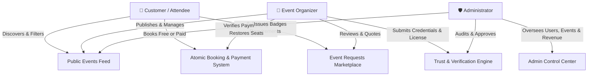

# EventSphere — Enterprise Event Management & Trust Platform

<p align="center">
  <b>A full-stack, enterprise-grade Java web application designed for campus and public event management, discovery, dual-mode payment ticketing, custom event quotation negotiations, organizer trust verification, and in-app notifications.</b>
</p>

---

## 🚀 Key Functional Modules & Role Matrix

EventSphere features three distinct role-based access control (RBAC) tiers: **Customer**, **Organizer**, and **Administrator**.



### 1. Customer (Attendee)
- **Dynamic Discovery & Search**: Interactive landing page and browse catalog with live search, category filtering (Gaming, Technical, Cultural, Sports, Workshops), and capacity status badges.
- **Atomic Booking**: Dual-checkout flow supporting **Free instant registration** and **Paid registration** (Sandbox Instant Gateway or Manual UPI QR upload).
- **Seat Capacity Protection**: Real-time capacity decrement preventing overbooking.
- **My Registrations & Cancellation**: Attendee self-service portal to view tickets, transaction IDs, payment statuses, and one-click cancellation with atomic seat release.
- **Custom Event Requests**: Post private event specifications (dates, guest count, budget, requirements) to receive competitive organizer quotations.
- **Proposal Review & Negotiation**: Compare itemized organizer quotations, accept/decline offers, and track confirmed custom bookings.

### 2. Event Organizer
- **Multi-Tenant Data Isolation**: Secure organizer dashboard strictly isolating analytics, revenue totals, participant rosters, and events.
- **Event Lifecycle Management**: Create, edit, and delete events with max capacity guards, venue details, and registration deadlines.
- **Payment Verification Workflow**: Review customer payment screenshots and UTR numbers with one-click **Approve** (confirms ticket) or **Reject** (releases reserved seat back to public inventory).
- **Custom Requests Marketplace**: Browse customer event requirements matching category specializations and build itemized proposal quotations (line-item services, quantities, prices, advance amounts).
- **Trust & Profile Verification**: Submit business license or campus organization proof to earn the **Verified Organizer** badge.

### 3. Administrator
- **Platform Analytics & KPIs**: Live platform counts for active customers, registered organizers, published events, total registrations, and platform revenue.
- **Organizer Verification Queue**: Vetting portal to inspect submitted licenses/documents, approve verification with audit timestamps, or reject with custom feedback.
- **Platform Governance**: Oversight and moderation over users, events, custom bookings, and payments.

### 4. Cross-Platform Real-Time Features
- **In-App Notification Center**: Floating bell widget with live pulsing unread badge counter, 30-second polling, and glassmorphic slide-out tray.
- **Dedicated Notifications Center (`notifications.jsp`)**: Filterable inbox for Bookings, Payments, Proposals, and Verification alerts.
- **Toast Feedback System**: Non-intrusive floating toasts (Success, Error, Warning, Info) with progress bar timers and automated URL flash parameter handling.

---

## 🛠️ Technology Stack

| Layer | Technology |
| :--- | :--- |
| **Runtime Environment** | Java SE 26 (JDK 26.0.1) |
| **Web Server / Servlet Container** | Apache Tomcat 10.1.57 (Jakarta EE 10) |
| **Database** | MySQL / MariaDB 10.4 (via XAMPP) on port `3306` |
| **Database Driver** | MySQL Connector/J 9.7.0 (`mysql-connector-j-9.7.0.jar`) |
| **Backend Architecture** | JSP (JavaServer Pages), DAO Pattern (`DBConnection`, `SecurityUtil`, `NotificationDAO`) |
| **Security & Hashing** | SHA-256 password hashing with backward-compatible legacy plaintext fallback |
| **Frontend Architecture** | Semantic HTML5, CSS3 Cosmic Dark Theme, Glassmorphism, Vanilla JavaScript ES6+ |

---

## 📂 Project Directory Structure

```
Eventsphere/
├── WEB-INF/
│   ├── classes/
│   │   └── database/
│   │       ├── DBConnection.class          # Centralized JDBC connection pool & auto-close
│   │       ├── SecurityUtil.class          # SHA-256 hashing & XSS sanitization
│   │       └── NotificationDAO.class       # In-App notification data access layer
│   └── web.xml                             # Servlet container descriptor
├── css/
│   ├── dashboard.css                       # Customer dashboard styles
│   ├── organizerDashboard.css              # Organizer dashboard styles
│   ├── notifications.css                   # Notification bell & dropdown styles
│   ├── toast.css                           # Glassmorphic toast notification styles
│   └── registrationForm.css                # Multi-step checkout & payment selector styles
├── js/
│   ├── dashboard.js                        # Dynamic search and filtering
│   ├── notifications.js                    # Notification polling, badge counter & dropdown
│   └── toast.js                            # URL flash message auto-detector & toast renderer
├── src/
│   └── database/
│       ├── DBConnection.java               # JDBC connection source
│       ├── SecurityUtil.java               # Security helper source
│       └── NotificationDAO.java            # Notification DAO source
├── tests/
│   └── verify_all_phases.ps1               # Automated end-to-end verification test suite
├── schema.sql                              # Complete MySQL database export (structure + seed)
├── index.jsp                               # Public landing page with event showcase & search
├── browseEvents.jsp                        # Category and keyword routing controller
├── login.jsp / loginProcess.jsp / logout.jsp # Authentication & role router
├── signup.jsp / register.jsp               # Customer & organizer registration
├── userDashboard.jsp                       # Customer dashboard & stats
├── organizerDashboard.jsp                  # Organizer multi-tenant dashboard
├── adminDashboard.jsp                      # Administrator platform control center
├── adminVerifications.jsp                  # Admin organizer vetting queue
├── adminProcessVerification.jsp            # Verification approval/rejection handler
├── notifications.jsp                       # Full-page notification command center
├── navbarNotification.jsp                  # Reusable notification bell component
├── registerEvent.jsp                       # Atomic booking & dual-payment transaction handler
├── cancelRegistration.jsp                  # Atomic booking cancellation & seat release
├── approvepayment.jsp / rejectPayment.jsp  # Organizer payment auditing
├── requestEvent.jsp / submitEventRequest.jsp # Custom event request flow
├── createProposal.jsp / submitProposal.jsp # Organizer quotation builder
├── viewProposals.jsp / respondProposal.jsp # Customer proposal review & acceptance
└── organizerProfile.jsp                    # Organizer trust settings & verification upload
```

---

## 🗄️ Database Architecture (`eventsphere`)

The relational schema includes **11 tables** enforcing data integrity and cascading foreign keys:

```
users ──────────────┬─────────────── organizer_profiles
  │                 │
  ├── events ───────┴─────────────── organizer_services
  │     │
  │     └── registrations ────────── payments
  │
  ├── event_requests ─────────────── proposals ── proposal_items
  │         │                            │
  │         └──── custom_event_bookings ─┘
  │
  └── notifications
```

To recreate the complete database with all tables, constraints, and seed data:
```bash
mysql -u root -e "CREATE DATABASE IF NOT EXISTS eventsphere;"
mysql -u root eventsphere < schema.sql
```

---

## ⚡ Setup & Deployment Instructions

### Prerequisites
1. **Java Development Kit (JDK 17 or higher, tested on JDK 26)** installed and set in `JAVA_HOME`.
2. **Apache Tomcat 10.1.x** installed and configured.
3. **MySQL / MariaDB** (via XAMPP or standalone) running on port `3306`.
4. `mysql-connector-j-9.7.0.jar` placed in Tomcat's `lib/` directory.

### Step 1: Clone Repository
```powershell
cd C:\apache-tomcat-10.1.57\webapps
git clone https://github.com/sarvagnakaribandi/event-management-system.git Eventsphere
```

### Step 2: Configure Tomcat Port (Optional)
If XAMPP or another service is bound to port `8080`, configure Tomcat 10 to use port `8081` in `C:\apache-tomcat-10.1.57\conf\server.xml`:
```xml
<Server port="8006" shutdown="SHUTDOWN">
    <Connector port="8081" protocol="HTTP/1.1" connectionTimeout="20000" redirectPort="8443" />
```

### Step 3: Compile Helper Classes
```powershell
cd C:\apache-tomcat-10.1.57\webapps\Eventsphere
& "C:\Program Files\Java\jdk-26.0.1\bin\javac.exe" -d "WEB-INF\classes" -cp "WEB-INF\classes;C:\apache-tomcat-10.1.57\lib\*" src\database\*.java
```

### Step 4: Import Database
```powershell
& "C:\xampp\mysql\bin\mysql.exe" -u root -e "CREATE DATABASE IF NOT EXISTS eventsphere;"
& "C:\xampp\mysql\bin\mysql.exe" -u root eventsphere < schema.sql
```

### Step 5: Start Servers & Launch
1. **Start MySQL** from XAMPP Control Panel.
2. **Start Tomcat 10**:
   ```powershell
   C:\apache-tomcat-10.1.57\bin\startup.bat
   ```
3. Open your browser and navigate to:
   > **`http://localhost:8081/Eventsphere/`**

---

## 🔑 Default Test Accounts

| Role | Email | Password | Access Portal |
| :--- | :--- | :--- | :--- |
| **Administrator** | `admin@eventsphere.com` | `Admin@123` | `http://localhost:8081/Eventsphere/adminDashboard.jsp` |
| **Organizer (Verified)** | `klo@sasi.ac.in` | `klo` | `http://localhost:8081/Eventsphere/organizerDashboard.jsp` |
| **Organizer (Pending)** | `dfg@sasi.ac.in` | `dfg` | `http://localhost:8081/Eventsphere/organizerDashboard.jsp` |
| **Customer / User** | `qwe@gmail.com` | `qwe` | `http://localhost:8081/Eventsphere/userDashboard.jsp` |

---

## 🧪 Automated End-to-End Testing

EventSphere includes an automated test runner validating the full stack across all phases:

```powershell
powershell -ExecutionPolicy Bypass -File tests/verify_all_phases.ps1
```

### Test Scope:
- **Group 1**: All 11 relational tables, column constraints, capacity tracking fields, and role ENUMs.
- **Group 2**: Unauthenticated guest redirection (HTTP 302) and public landing page availability (HTTP 200).
- **Group 3**: Dynamic category filters and search routers.
- **Group 4**: In-app notifications REST API authentication, JSON payload formatting, and mark-all-read routines.
- **Group 5**: Proposals and custom event bookings lifecycle.
- **Group 6**: Administrator metric aggregations and trust verification status.

---

## 📈 Implementation Phases Summary

| Phase | Milestone | Commits | Status |
| :---: | :--- | :---: | :---: |
| **Phase 1** | Comprehensive Architecture & Security Audit Plan | Audit Report | ✅ Complete |
| **Phase 2** | DBConnection Helper, Password Hashing & Multi-Tenant Data Isolation | [`41bcf97`](https://github.com/sarvagnakaribandi/event-management-system/commit/41bcf97) | ✅ Complete |
| **Phase 3** | Customer Dynamic Discovery, Capacity Guards & Self-Service Cancellation | [`5d53d11`](https://github.com/sarvagnakaribandi/event-management-system/commit/5d53d11) | ✅ Complete |
| **Phase 4** | Atomic Booking Engine, Dual-Mode Payments & Payment Sync | [`90db981`](https://github.com/sarvagnakaribandi/event-management-system/commit/90db981) | ✅ Complete |
| **Phase 5** | Custom Event Request System & Itemized Proposal Quotation Builder | [`e5b445f`](https://github.com/sarvagnakaribandi/event-management-system/commit/e5b445f) | ✅ Complete |
| **Phase 6** | Organizer Verification Trust Badge & Administrator Control Center | [`8037594`](https://github.com/sarvagnakaribandi/event-management-system/commit/8037594) | ✅ Complete |
| **Phase 7** | In-App Notification Center, Real-Time Polling & Toast Alerts | [`1e3dbf2`](https://github.com/sarvagnakaribandi/event-management-system/commit/1e3dbf2) | ✅ Complete |
| **Phase 8** | Complete Automated Verification Suite, Schema Dump & Documentation | [`f189d2c`](https://github.com/sarvagnakaribandi/event-management-system/commit/f189d2c) | ✅ Complete |

---

## 📄 License
This project is developed for educational and enterprise event management purposes.
All rights reserved © EventSphere.
